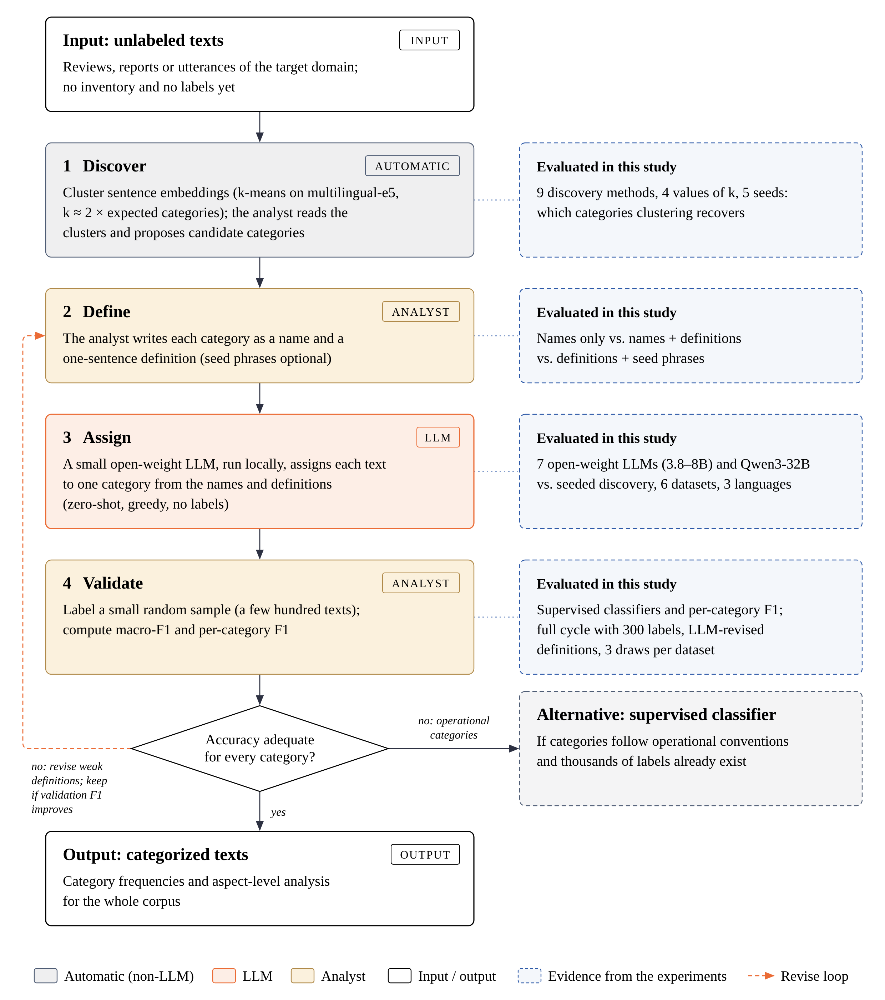

# D2D: A Discover–Define–Assign Framework for Aspect Category Analysis with Local LLMs

Code for the paper *D2D: A Discover–Define–Assign Framework for Aspect Category Analysis with Local LLMs*.

Analysts often cluster customer texts both to find out which aspects people talk about and to count how often each aspect comes up.
D2D keeps clustering for the first job only. Discovery proposes candidate categories. The analyst writes a name and a one-sentence
definition for each. A small open-weight LLM, run locally, assigns every text to a category without labeled data. A few hundred
labeled texts are then used to check the result and to revise weak definitions.



On six datasets in English, Arabic, and Thai (6 to 23 categories):

- When used to assign texts, nine discovery methods reached at most 0.27–0.40 macro-F1.
- Qwen3-8B, given only category names and definitions, reached 0.48–0.77.
- With 300 labeled texts, the full cycle outperformed cluster mapping and supervised classifiers trained on the same labels, by 0.06–0.22.

## Repository layout

```
d2d/                    the framework, one module per concern
  config.py             paths, dataset settings, model IDs
  data.py               loaders for the six datasets (discovery, mapping, and test sets)
  text.py               English, Arabic, and Thai tokenizers
  embeddings.py         multilingual-e5-large sentence and word embeddings
  discovery.py          Discover: A1, A2, B1, C1, C3, C3R, E1top (unsupervised); D1, A2S (seeded)
  cat.py                Discover: CAt (seeded attention over word vectors)
  llm.py                Define + Assign: prompt, answer parsing, zero-shot classification
  revise.py             Validate + Revise: weak categories, definition rewriting, acceptance check
  baselines.py          cluster-to-category mapping, nearest centroid, logistic regression, random
  metrics.py            macro-F1 and the review-level bootstrap
scripts/                one script per experiment (run in this order)
  run_discovery.py      all discovery methods, CAt, supervised baselines, bootstrap (per dataset)
  run_llm.py            zero-shot assignment with local LLMs
  score_llm.py          macro-F1 of the LLMs and comparison with CAt
  run_d2d.py            end-to-end Assign–Validate–Revise evaluation with 300 labels
  make_tables.py        Tables 3–5 and summary statistics
  make_figures.py       Figures 2–4
categories/             category inventories: name, one-sentence definition, three seed phrases
data/                   datasets (not included; see data/README.md)
docs/framework.png      Figure 1
```

## Installation

```bash
python -m venv .venv && source .venv/bin/activate
pip install -r requirements.txt
```

The experiments were run with Python 3.12 on NVIDIA V100 (32 GB) GPUs.

- Qwen3-8B and the other 4–8B models run in half precision on one GPU.
- Qwen3-32B was split across several GPUs (`--max-memory`).
- Every model runs locally. No text is sent to an external service.

To run offline after the first download, set `HF_HUB_OFFLINE=1`. The figures use Liberation Serif if it is installed in `~/.fonts` (otherwise Times New Roman or DejaVu Serif).

## Data

Download the six datasets and place them under `data/` as described in [data/README.md](data/README.md). The TrueVoice data are
provided courtesy of TrueVoice for educational purposes only and are not redistributed here.

## Reproducing the paper

All outputs go to `results/`. Set `D2D_RESULTS` to write them somewhere else.

```bash
# 1. Discover: nine clustering methods x 4 numbers of clusters x 5 seeds, CAt, supervised baselines
for d in restaurants laptops coursera arhotels thaifin truevoice; do
    python scripts/run_discovery.py $d
done

# 2. Assign: zero-shot classification (Qwen3-8B with three prompt conditions; other models with definitions)
python scripts/run_llm.py Qwen/Qwen3-8B Qwen/Qwen3-4B Qwen/Qwen2.5-7B-Instruct \
    scb10x/llama3.1-typhoon2-8b-instruct ibm-granite/granite-3.3-8b-instruct \
    mistralai/Mistral-7B-Instruct-v0.3 microsoft/Phi-4-mini-instruct --device cuda:0
python scripts/run_llm.py Qwen/Qwen3-32B --max-memory "0:30GiB,1:30GiB,2:30GiB"
python scripts/score_llm.py

# 3. Validate and Revise: the full cycle with 300 labels, 3 draws per dataset
python scripts/run_d2d.py --device cuda:0

# 4. Tables and figures
python scripts/make_tables.py
python scripts/make_figures.py
```

Every step caches its output, so an interrupted run resumes where it stopped. Delete the cached files to recompute them:
embeddings and cluster labels in `results/discovery/<dataset>/`, LLM answers in `results/llm/*.npy`, and end-to-end runs in `results/d2d/*.json`.

| Paper | Output |
|---|---|
| Table 1 (datasets) | printed by `run_discovery.py` |
| Table 3 (all methods) | `results/tables/table3_methods.md` |
| Table 4 (LLMs and prompts) | `results/tables/table4_llms.md` |
| Table 5 (end-to-end) | `results/tables/table5_end_to_end.md` |
| Figure 2 | `results/figures/fig2_overview.png` |
| Figure 3 | `results/figures/fig3_seeds.png` |
| Figure 4 | `results/figures/fig4_per_category.png` |
| Bootstrap intervals (discovery) | `results/discovery/<dataset>/bootstrap.csv` |
| Kendall's τ, share of categories with F1 = 0 | `results/tables/summary.txt` |

### Protocol in brief

- **Mapping.** Every discovery method assigns each text to a cluster or to noise. Each cluster is then mapped to the most common category among its labeled mapping texts. Noise and unmapped clusters count as errors.
- **Numbers of clusters.** 1–4× the number of categories for Restaurants and Coursera, and 0.5–3× for the other datasets. The main setting is 2×.
- **Seeds.** Five random seeds per method.
- **Measure.** Macro-F1 over the categories present in the test set.
- **Significance.** Pairwise differences are tested with a 1,000-sample bootstrap in which texts from the same review are resampled together.
- **CAt.** The kernel width γ is chosen by two-fold cross-validation on the mapping set.
- **LLMs.** Greedy decoding, at most 12 new tokens, Qwen3 reasoning mode off. The prompts were not tuned.
- **End-to-end evaluation.** A category with validation F1 below 0.6 is weak. Qwen3-8B rewrites its definition from up to six missed and six wrongly assigned validation texts. A revision is kept only if validation macro-F1 improves.

LLM answers can differ slightly across GPUs, library versions, and batch sizes. The cached answers in `results/llm/` determine the reported numbers.

## Using D2D on your own data

```python
from d2d.config import DatasetSpec
from d2d.llm import classify, load_model
from d2d.revise import revise_definitions, weak_categories

# Define: one short name and a one-sentence definition per category
categories = {
    "ROOM": {"definition": "The guest room itself: size, bed, cleanliness, noise, and view.", "seeds": []},
    "STAFF": {"definition": "Hotel employees: friendliness, helpfulness, and speed of service.", "seeds": []},
    "HOTEL": {"definition": "The hotel as a whole, including overall value; use this only if no other category fits.", "seeds": []},
}
spec = DatasetSpec(name="my_hotels", lang="en", ks=(), k_main=0, language="English",
                   unit="review sentence", domain="hotel reviews")

# Assign: zero-shot, local model
tok, model = load_model("Qwen/Qwen3-8B", device="cuda:0")
pred, raw = classify(tok, model, spec, categories, texts)

# Validate and Revise: label a few hundred texts (val_texts, y_val), find weak categories, rewrite them
pred_val, _ = classify(tok, model, spec, categories, val_texts)
weak = weak_categories(categories, y_val, pred_val, labels=sorted(set(y_val)))
revised = revise_definitions(tok, model, spec, categories, weak, val_texts, y_val, pred_val)
# Keep `revised` only if macro-F1 on the validation texts improves.
```

For the Discover stage, cluster sentence embeddings (`d2d.embeddings.encode`) with k-means at about twice the number of
categories you expect. Then read the texts closest to each centroid to propose categories. Use the clusters only to propose
categories, not to assign texts or count them.

## Category inventories

`categories/<dataset>.json` holds, for every category, the one-sentence English definition used in the LLM prompt and three
seed phrases in the language of the data (the Arabic file also includes English glosses).

- **Definitions.** Based on each dataset's annotation guidelines or documentation.
- **Seed phrases.** Written by an LLM (Claude, Anthropic) from the definitions alone, without access to any texts or labels.
- **Gold labels.** All gold labels are the original human annotations of each dataset.

## Citation

```bibtex
@article{d2d,
  title   = {D2D: A Discover--Define--Assign Framework for Aspect Category Analysis with Local LLMs},
  author  = {Sroytong, Pairat and Valeeprakhon, Tamnuwat},
  note    = {Under review},
  year    = {2026}
}
```

## License

Code license: to be added. The datasets keep their own terms (see [data/README.md](data/README.md)).
